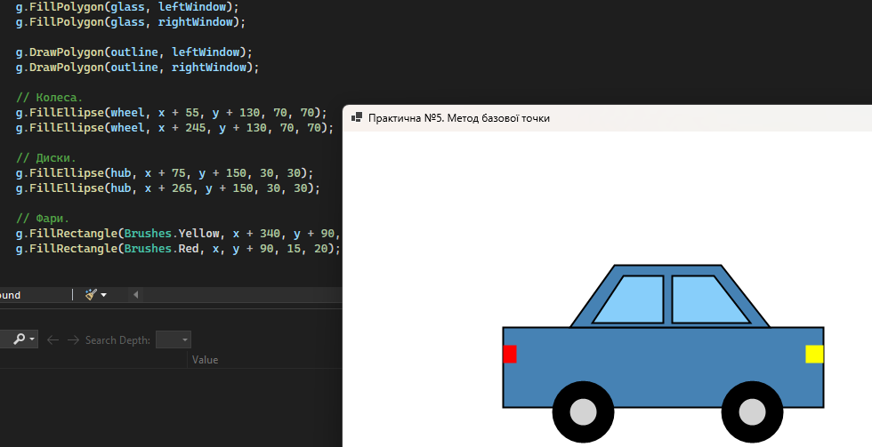

# Практична робота №5. Побудова зображення методом базової точки

- Мова програмування: C#

- Технологія: Windows Forms (.NET 8.0)

- Середовище розробки: Visual Studio Community 2022

## Мета роботи

Навчитися будувати графічні зображення методом базової точки.

## Завдання

Побудувати довільне графічне зображення методом базової точки.

## Реалізація

Створено застосунок `BasePointDrawing`, який відображає автомобіль засобами класу `Graphics`.

Малювання реалізовано в методі `DrawCar(Graphics g, int x, int y)`.
Координати всіх елементів обчислюються відносно базової точки `(x, y)`.

Використано методи `FillRectangle`, `DrawRectangle`,`FillPolygon`, `DrawPolygon`,
`FillEllips`e та згладжування `SmoothingMode.AntiAlias`.

## Результати

Автомобіль успішно відображається у формі. Зміна координат базової точки забезпечує 
переміщення всього зображення без зміни взаємного розташування елементів.

