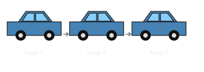
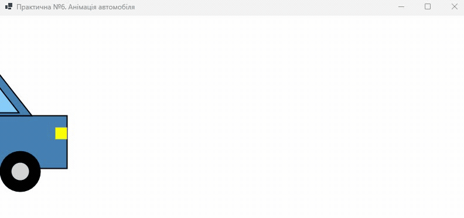

# Практична робота №6. Створення анімації засобами C#

- Мова програмування: C#
- Технологія: Windows Forms (.NET 8.0)
- Середовище розробки: Visual Studio Community 2022

## Мета роботи

Навчитися створювати анімацію графічних об'єктів за допомогою компонента `Timer`.

## Завдання

- Використати кольорове зображення, побудоване методом базової точки у практичній роботі №5.
- Реалізувати побудову графічного об'єкта у вигляді функції.
- Організувати переміщення об'єкта за допомогою події `Tick` компонента `Timer`.

## Реалізація

> Для створення анімації повторно використано метод `DrawCar(Graphics g, int x, int y)`, реалізований у
> практичній роботі №5. Метод забезпечує побудову автомобіля відносно базової точки, координати якої
> змінюються під час анімації.

`Timer.Tick` змінює `carX`, `Invalidate()` запитує перемальовування, а `OnPaint()` викликає `DrawCar()`
з новими координатами. `DoubleBuffered = true` зменшує мерехтіння під час руху.

## Результат

