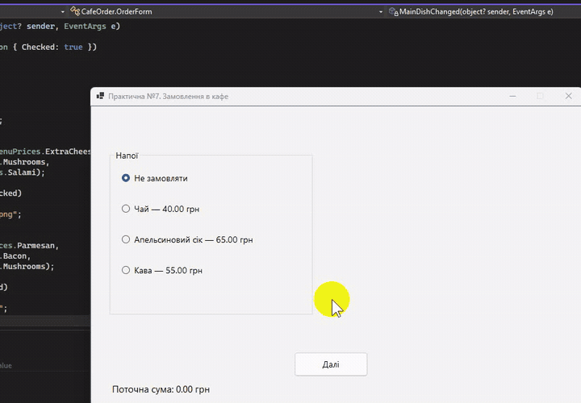

# Практична робота №7. Розробка застосунку з елементами керування

- Мова програмування: C#
- Технологія: Windows Forms (.NET 8.0)
- Середовище розробки: Visual Studio Community 2022

## Мета роботи

Навчитися використовувати елементи керування `CheckBox`, `RadioButton` та `GroupBox` у Windows Forms.

## Завдання

Розробити програму обчислення вартості замовлення в кафе.

- Забезпечити вибір страв за допомогою `CheckBox` і `RadioButton`.
- Передбачити складну страву, наповнення якої обирає клієнт.
- Зробити компоненти вибору наповнення неактивними або невидимими до вибору відповідної страви.
- Автоматично перераховувати вартість замовлення при виборі або скасуванні страв.
- Врахувати можливість знижки.
- Відображати зображення вибраних страв.

## Реалізація

### Структура меню

Користувач може замовити по одній позиції з кожної категорії: напій, першу та другу страву.
Кожна категорія має варіант «Не замовляти».

| Категорія     | Страва            | Файл зображення       | Інгредієнти |
|---------------|-------------------|-----------------------|-------------|
| Напої         | Чай               | tea.png               | Ні          |
| Напої         | Апельсиновий сік  | orange_juice.png      | Ні          |
| Напої         | Кава              | coffee.png            | Ні          |
| Перші страви  | Курячий суп       | chicken_soup.png      | Ні          |
| Перші страви  | Український борщ  | ukrainian_borscht.png | Ні          |
| Перші страви  | Солянка           | solyanka.png          | Ні          |
| Другі страви  | Піца              | pizza.png             | Так         |
| Другі страви  | Спагеті           | spaghetti.png         | Так         |
| Другі страви  | Бургер            | burger.png            | Так         |

Для других страв інгредієнти впливають на ціну, але не змінюють зображення.

### Структура файлів

```text
practical-07-cafe-order/
├── assets/
│   └── images/
│       ├── tea.png
│       ├── orange_juice.png
│       ├── coffee.png
│       ├── chicken_soup.png
│       ├── ukrainian_borscht.png
│       ├── solyanka.png
│       ├── pizza.png
│       ├── spaghetti.png
│       └── burger.png
├── screenshots/
├── MenuPrices.cs
├── OrderForm.cs
├── OrderForm.Designer.cs
├── OrderForm.Drinks.cs
├── OrderForm.Soups.cs
├── OrderForm.MainDishes.cs
├── OrderForm.Summary.cs
├── OrderForm.Pricing.cs
├── Program.cs
├── CafeOrder.csproj
└── README.md
```

Логіку застосунку розділено між кількома файлами часткового класу `OrderForm` (`partial class`).
Це дозволяє відокремити обробку вибору напоїв, перших і других страв, розрахунок вартості 
та формування підсумку замовлення.

- `OrderForm.cs` — ініціалізація форми та навігація між кроками.
- `OrderForm.Designer.cs` — автоматично згенерований код компонентів інтерфейсу.
- `OrderForm.Drinks.cs`, `OrderForm.Soups.cs`, `OrderForm.MainDishes.cs` — обробка вибору страв і відображення зображень.
- `OrderForm.Pricing.cs` — розрахунок поточної вартості та оновлення цін в інтерфейсі.
- `OrderForm.Summary.cs` — формування підсумку замовлення, застосування знижки та скидання вибраних позицій.
- `MenuPrices.cs` — централізоване визначення цін і розміру знижки.

Щоб зображення автоматично копіювалися до каталогу збірки, додано в `CafeOrder.csproj`:

```xml
<ItemGroup>
  <Content Include="assets\images\*">
    <CopyToOutputDirectory>PreserveNewest</CopyToOutputDirectory>
  </Content>
</ItemGroup>
```

- `Content` позначає файли як ресурси вмісту застосунку.
- `Include` визначає, які файли включити.
- `PreserveNewest` копіює файл, якщо його немає в каталозі призначення або вихідний файл новіший.

Для завантаження в програмі:

```csharp
string path = Path.Combine(
    AppContext.BaseDirectory,
    "assets", "images", "pizza.png"
);
```

### Налаштування OrderForm у дизайнері

| Властивість       | Значення                          | Опис                                          |
|-------------------|-----------------------------------|-----------------------------------------------|
| `(Name)`          | `OrderForm`                       | Назва класу форми для звернення з коду        |
| `Text`            | `Практична №7. Замовлення в кафе` | Заголовок вікна                               |
| `Size`            | `816, 600`                        | Ширина та висота форми в пікселях             |
| `StartPosition`   | `CenterScreen`                    | Розташування вікна по центру екрана           |
| `FormBorderStyle` | `FixedSingle`                     | Фіксована рамка без зміни розміру мишею       |
| `MaximizeBox`     | `False`                           | Вимикає кнопку розгортання вікна              |
| `BackColor`       | `WhiteSmoke`                      | Колір фону форми                              |
| `Font`            | `Segoe UI, 10pt`                  | Шрифт форми та успадкований шрифт компонентів |

### Таблиця найменувань усіх компонентів

| Компонент   | Name              | Text / призначення                 |
|-------------|-------------------|------------------------------------|
| Form        | OrderForm         | Замовлення в кафе                  |
| Panel       | panelDrinks       | Крок 1. Напої                      |
| Panel       | panelSoups        | Крок 2. Перші страви               |
| Panel       | panelMainDishes   | Крок 3. Другі страви               |
| Panel       | panelSummary      | Крок 4. Підсумок                   |
| GroupBox    | groupDrinks       | Напої                              |
| GroupBox    | groupSoups        | Перші страви                       |
| GroupBox    | groupMainDishes   | Другі страви                       |
| GroupBox    | groupIngredients  | Додаткові інгредієнти              |
| GroupBox    | groupDiscount     | Знижка                             |
| RadioButton | radioNoDrink      | Не замовляти                       |
| RadioButton | radioTea          | Чай                                |
| RadioButton | radioJuice        | Апельсиновий сік                   |
| RadioButton | radioCoffee       | Кава                               |
| RadioButton | radioNoSoup       | Не замовляти                       |
| RadioButton | radioChickenSoup  | Курячий суп                        |
| RadioButton | radioBorscht      | Український борщ                   |
| RadioButton | radioSolyanka     | Солянка                            |
| RadioButton | radioNoMainDish   | Не замовляти                       |
| RadioButton | radioPizza        | Піца                               |
| RadioButton | radioSpaghetti    | Спагеті                            |
| RadioButton | radioBurger       | Бургер                             |
| CheckBox    | checkIngredient1  | Інгредієнт 1                       |
| CheckBox    | checkIngredient2  | Інгредієнт 2                       |
| CheckBox    | checkIngredient3  | Інгредієнт 3                       |
| RadioButton | radioNoDiscount   | Без знижки                         |
| RadioButton | radioStudent      | Студентська 10%                    |
| PictureBox  | pictureDrink      | Зображення напою                   |
| PictureBox  | pictureSoup       | Зображення першої страви           |
| PictureBox  | pictureMainDish   | Зображення другої страви           |
| ListBox	   | listOrderItems	   | Склад замовлення                   |
| Label	   | labelDrinksTotal  | Поточна сума на кроці напоїв       |
| Label	   | labelSoupsTotal   | Поточна сума на кроці перших страв |
| Label	   | labelMainTotal	   | Поточна сума на кроці других страв |
| Label       | labelTotalCaption | До сплати:                         |
| Label       | labelTotal        | 0,00 грн                           |
| Button      | buttonDrinksNext  | Далі                               |
| Button      | buttonSoupsBack   | Назад                              |
| Button      | buttonSoupsNext   | Далі                               |
| Button      | buttonMainBack    | Назад                              |
| Button      | buttonMainNext    | Далі                               |
| Button      | buttonSummaryBack | Назад                              |
| Button      | buttonNewOrder    | Нове замовлення                    |

> Радіокнопки кожної незалежної групи вибору необхідно розміщувати в окремому контейнері `GroupBox`,
> щоб вибір у різних категоріях не впливав один на одного.

### Початкові значення RadioButton

| Компонент       | Властивість | Значення |
|-----------------|-------------|----------|
| radioNoDrink    | Checked     | True     |
| radioNoSoup     | Checked     | True     |
| radioNoMainDish | Checked     | True     |
| radioNoDiscount | Checked     | True     |

Усі інші радіокнопки з Checked = `False`.

### Інгредієнти других страв

| Страва   | checkIngredient1   | checkIngredient2 | checkIngredient3 |
|----------|--------------------|------------------|------------------|
| Піца     | Додатковий сир     | Гриби            | Салямі           |
| Спагеті  | Пармезан           | Бекон            | Гриби            |
| Бургер   | Додаткова котлета  | Сир              | Бекон            |

При зміні другої страви програма повинна:

1. Замінити зображення.
2. Оновити підписи інгредієнтів.
3. Скинути попередній вибір інгредієнтів.
4. Перерахувати суму замовлення.

## Покрокове оформлення замовлення

Одна `OrderForm` міститиме чотири панелі, з яких одночасно видима лише одна. 
Вибрані значення зберігатимуться під час переходів вперед і назад.

На кожному з перших трьох кроків відображається поточна сума замовлення, 
яка враховує всі вибрані позиції на момент розрахунку. Значення автоматично 
оновлюється при зміні страви або додаткових інгредієнтів.

Назви страв у `RadioButton` містять їхню вартість. Для других страв підписи 
`CheckBox` динамічно змінюються відповідно до вибраної страви та містять ціни 
додаткових інгредієнтів.

При виборі «Не замовляти» для другої страви група інгредієнтів блокується, 
позначки скидаються, а підписи повертаються до початкових значень.

| Компонент | Name            | Призначення          |
|-----------|-----------------|----------------------|
| Panel     | panelDrinks     | Крок 1. Напої        |
| Panel     | panelSoups      | Крок 2. Перші страви |
| Panel     | panelMainDishes | Крок 3. Другі страви |
| Panel     | panelSummary    | Крок 4. Підсумок     |

### Крок 1. Напої

- `RadioButton + PictureBox`
- `Далі`

> Кнопка «Назад» не потрібна, оскільки це початковий екран.

### Крок 2. Перші страви

- `RadioButton + PictureBox`
- `Назад / Далі`

### Крок 3. Другі страви

- `RadioButton + CheckBox + PictureBox`
- `Назад / Далі`

> При зміні другої страви потрібно скидати вибрані інгредієнти.
> При поверненні з четвертого кроку на третій - навпаки, зберігати їх.

### Крок 4. Підсумок замовлення

- `Список позицій`, `знижка RadioButton`, `загальна вар`
- `Назад / Нове замовлення`

### Логіка розрахунку

Для демонстрації використано умовні ціни, централізовано визначені у файлі `MenuPrices.cs` 
як константи типу `decimal`. Це дозволяє змінювати вартість страв та інгредієнтів без 
редагування логіки розрахунку.

Ціни використовуються одночасно для обчислення вартості замовлення та формування підписів елементів керування.

| Категорія    | Страва            | Ціна, грн |
|--------------|-------------------|-----------|
| Напої        | Чай               | 40        |
| Напої        | Апельсиновий сік  | 65        |
| Напої        | Кава              | 55        |
| Перші страви | Курячий суп       | 95        |
| Перші страви | Український борщ  | 110       |
| Перші страви | Солянка           | 125       |
| Другі страви | Піца              | 180       |
| Другі страви | Спагеті           | 160       |
| Другі страви | Бургер            | 170       |

Так само ціни додаткових інгредієнтів також визначимо в коді.
Наприклад, додатковий **сир** для піци коштуватиме `25 грн`, **гриби** `20 грн`, **салямі** `35 грн`.

Розрахунок виконується автоматично при зміні вибраних позицій. На перших трьох кроках відображається 
проміжна сума без знижки. На підсумковому екрані користувач може обрати студентську знижку 10%, 
після чого загальна вартість перераховується.

Для грошових розрахунків використовується тип `decimal`, а значення в інтерфейсі відображаються 
з точністю до двох знаків після десяткового роздільника.

$$
\text{Сума}=(\text{Напій}+\text{Перша страва}+\text{Друга страва}+\text{Інгредієнти})\times(1-\text{Знижка})
$$

## Результат

