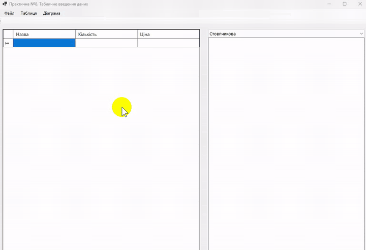

# Практична робота №8. Табличне введення даних

- Мова програмування: C#
- Технологія: Windows Forms (.NET 8.0)
- Середовище розробки: Visual Studio Community 2022

## Мета роботи

Навчитися працювати з табличними даними за допомогою `DataGridView`, `DataTable` і `DataSet`, 
зберігати дані у форматі XML та будувати графіки за допомогою `Chart`.

## Завдання

- Створити Windows Forms застосунок відповідно до обраного варіанта.
- Додати `MenuStrip`, `ContextMenuStrip` і `ToolStrip`.
- Організувати табличне введення та відображення даних у `DataGridView`.
- Реалізувати збереження таблиці у файл XML.
- Реалізувати відкриття раніше збереженого XML-файлу.
- Побудувати графік за табличними даними за допомогою `Chart`.

## Реалізація

Застосунок реалізовано на основі `DataTable` із трьома стовпцями: **Назва** (`string`), **Кількість** (`int`) 
і **Ціна** (`decimal`). Таблиця прив'язана до `DataGridView`, що забезпечує введення та редагування даних.

Через головне та контекстне меню реалізовано створення нової таблиці, відкриття й збереження XML-файлів. 
Головне меню також дозволяє додавати та видаляти рядки, оновлювати діаграму й завершувати роботу програми.

Для збереження використано `DataTable.WriteXml()` із параметром `XmlWriteMode.WriteSchema`, 
для відкриття — `DataTable.ReadXml()`.

Діаграми побудовано без використання готового компонента `Chart`. Малювання виконується на `Panel` 
засобами `System.Drawing` через подію `Paint`.

Для кожного товару обчислюється загальна вартість:

**Вартість = Кількість × Ціна**

За допомогою `ComboBox` можна вибрати один із двох типів діаграм: стовпчикову або лінійну. Масштабування виконується 
відносно найбільшого значення вартості. Товари з нульовою вартістю не відображаються.

Для уникнення накладання підписів на горизонтальній осі використовуються порядкові номери товарів. Якщо записів 
понад 15, відображається кожен п'ятий номер, а якщо понад 30 — кожен десятий.

Діаграма перемальовується після зміни даних, вибору іншого типу діаграми, зміни розміру панелі або виконання 
команди оновлення. У рядку стану відображається поточна кількість записів.

## Компоненти інтерфейсу

| Компонент              | Name               | Призначення                    |
|------------------------|--------------------|--------------------------------|
| `Form`                 | `TableEditorForm`  | Головна форма                  |
| `MenuStrip`            | `menuMain`         | Головне меню                   |
| `ContextMenuStrip`     | `menuTableContext` | Контекстне меню таблиці        |
| `ToolStrip`            | `toolMain`         | Панель інструментів            |
| `DataGridView`         | `gridData`         | Введення та редагування даних  |
| `SplitContainer`       | `splitMain`        | Розділення таблиці та діаграми |
| `ComboBox`             | `comboChartType`   | Вибір типу діаграми            |
| `Panel`                | `panelChart`       | Малювання діаграми             |
| `StatusStrip`          | `statusMain`       | Рядок стану                    |
| `ToolStripStatusLabel` | `statusRows`       | Кількість записів              |

## Результати

У результаті виконання практичної роботи створено Windows Forms застосунок для роботи з табличними даними.

Реалізовано додавання, редагування та видалення товарів, збереження таблиці у форматі XML разом зі схемою даних і відновлення записів із файлу.

Реалізовано два способи графічного представлення даних — стовпчикову та лінійну діаграми — з можливістю перемикання між ними.

Перевірено роботу основних операцій із таблицею, збереження та відкриття XML-файлів, а також відображення діаграм для наборів даних із великою кількістю записів.

