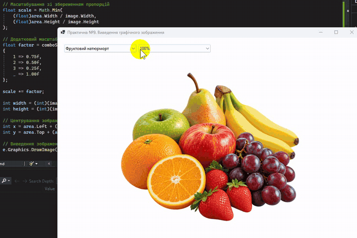

# Практична робота №9. Виведення графічного зображення у форму

- Мова програмування: C#
- Технологія: Windows Forms (.NET 8.0)
- Середовище розробки: Visual Studio Community 2022

## Мета роботи

Ознайомитися з виведенням растрових зображень у Windows Forms засобами класу `Graphics`.

## Завдання

- Створити Windows Forms застосунок.
- Завантажити графічне зображення з файлу.
- Вивести зображення у форму за допомогою `Graphics.DrawImage()`.
- Використати перевизначення методу `OnPaint()`.
- Продемонструвати виведення зображення у вихідному розмірі та з масштабуванням.

## Реалізація

Створено Windows Forms застосунок `ImageRendering` із головною формою `ImageForm`. 
Для відображення використано три PNG-зображення, розміщені в каталозі `assets`.

| Файл                        | Зображення            |
|-----------------------------|-----------------------|
| `fruit_still_life.png`      | Фруктовий натюрморт   |
| `bouquet_autumn_leaves.png` | Букет осіннього листя |
| `frog.png`                  | Жаба                  |

Керування здійснюється через два компоненти `ComboBox`:

- `comboImage` — вибір зображення.
- `comboScale` — вибір масштабу: 100%, 75%, 50%, 25%.

Зображення завантажуються з файлів, а їх виведення реалізовано перевизначенням методу `OnPaint()` 
із використанням `Graphics.DrawImage()`.

Масштабування виконується зі збереженням пропорцій:

```csharp
float scale = Math.Min(
    (float)area.Width / image.Width,
    (float)area.Height / image.Height
);

scale *= factor;
```

За 100% зображення вписується в доступну область форми. Інші значення зменшують його відносно цього розміру. 
Після зміни зображення, масштабу або розмірів вікна виконується повторне малювання через `Invalidate()`.

## Результати

- Реалізовано завантаження та відображення трьох PNG-зображень.
- Забезпечено перемикання зображень і чотири рівні масштабування.
- Реалізовано автоматичне центрування зі збереженням пропорцій.
- Використано `OnPaint()` і `Graphics.DrawImage()` без додаткових графічних бібліотек.

Практично опрацьовано завантаження растрових файлів, роботу з класом `Graphics` 
та перемальовування графічного вмісту Windows Forms.

