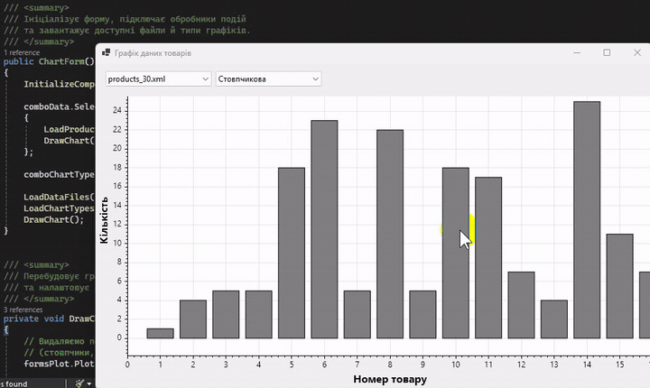

# Практична робота №10. Побудова графіка методами класу Graphics

- Мова програмування: C#
- Технологія: Windows Forms (.NET 8.0)
- Середовище розробки: Visual Studio Community 2022

## Мета роботи

Навчитися будувати графіки засобами класу `Graphics` у Windows Forms.

## Завдання

- Створити Windows Forms застосунок.
- Використати дані, отримані у практичній роботі №8.
- Побудувати графік методами класу `Graphics`.
- Відобразити побудований графік у формі.
- Дати відповіді на контрольні питання про `PictureBox`, `OpenFileDialog`, `SaveFileDialog` та властивість `Dock`.

> Примітка. У практичних роботах №8 і №10 способи побудови графіків були поміняні місцями. 
> У №8 графіки побудовано вручну методами класу Graphics, а в №10 використано готовий компонент 
> FormsPlot бібліотеки ScottPlot. Бібліотеку обрано через відсутність стандартного компонента Chart 
> у Windows Forms на .NET 8.

## Реалізація

Створено Windows Forms застосунок `GraphicsChart` із головною формою `ChartForm`. 
Для побудови діаграм використано бібліотеку **ScottPlot.WinForms 5.1.59**, встановлену через NuGet.

Джерелом даних є XML-файли `products_30.xml` і `products_60.xml` із практичної роботи №8. 
Файли автоматично визначаються в каталозі `data`, а їхній вміст зчитується методом `DataTable.ReadXml()`.

Структура даних:

| Поле XML    | Тип       | Призначення         |
|-------------|-----------|---------------------|
| `Назва`     | `string`  | Найменування товару |
| `Кількість` | `int`     | Кількість одиниць   |
| `Ціна`      | `decimal` | Ціна товару         |

Реалізовано п'ять способів візуалізації:

| Тип діаграми         | Метод                | Відображувані дані               |
|----------------------|----------------------|----------------------------------|
| Стовпчикова          | `DrawBarChart()`     | Кількість товарів                |
| Лінійна              | `DrawLineChart()`    | Кількість за порядковим номером  |
| Кругова              | `DrawPieChart()`     | ТОП-10 товарів та інші           |
| Точкова              | `DrawScatterChart()` | Співвідношення ціни та кількості |
| Гістограма розподілу | `DrawHistogram()`    | Частоти за ціновими інтервалами  |

Перемикання XML-файлів і типів діаграм виконується через два компоненти `ComboBox`. 
Побудова централізована в методі `DrawChart()`:

```csharp
formsPlot.Plot.Clear();
formsPlot.Plot.Axes.AutoScale();
formsPlot.Refresh();
```

ScottPlot забезпечує інтерактивне масштабування колесом миші та переміщення графіків перетягуванням. 
Для стовпчикової та лінійної діаграм початково відображається область із 15 товарами.

## Результати

- Реалізовано завантаження XML-даних із практичної роботи №8.
- Побудовано п'ять типів діаграм на основі кількості та ціни товарів.
- Забезпечено автоматичне перемикання наборів даних і типів графіків.
- Реалізовано інтерактивне масштабування, переміщення та налаштування координатних осей.

У результаті опрацьовано побудову й відображення графіків у Windows Forms із використанням ScottPlot,
а також повторно використано табличні дані попередньої практичної роботи.

