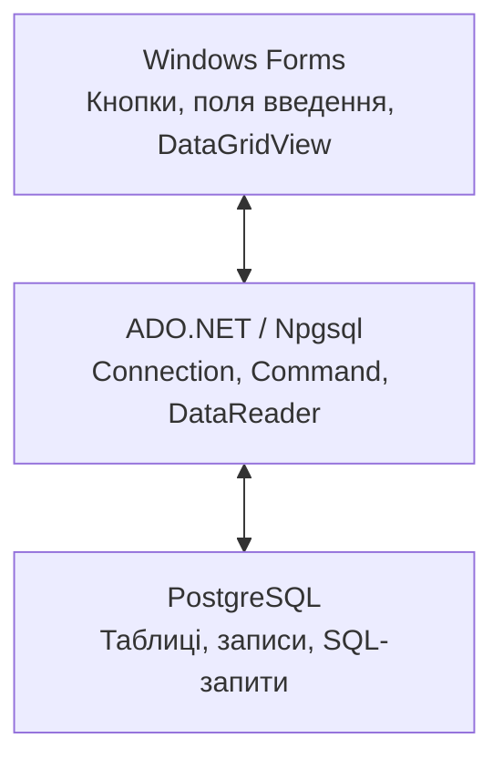
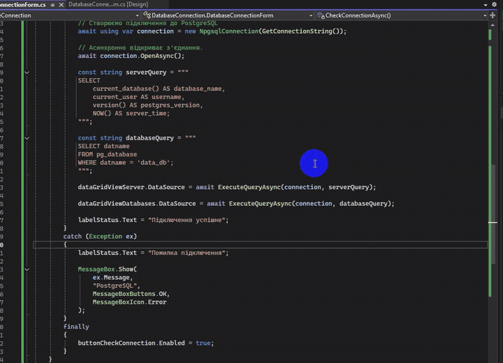

# Практична робота №11. Підключення до бази даних у C#

- Мова програмування: C#
- Технологія: Windows Forms (.NET 8.0)
- Середовище розробки: Visual Studio Community 2022
- СУБД: PostgreSQL
- Доступ до даних: ADO.NET, Npgsql

## Мета роботи

Навчитися програмно створювати структуру бази даних і працювати з нею засобами ADO.NET.

## Завдання

- Розробити таблицю щонайменше з шістьма полями.
- Передбачити цілочисельні, текстові та числові поля з плаваючою комою.
- Програмно створити базу даних.
- Створити структуру таблиці за допомогою ADO.NET.
- Перевірити підключення та виконання SQL-команд.

## Особливості реалізації

Замість MS Access (`.mdb`), наведеного в завданні, використовується PostgreSQL 
із провайдером Npgsql. Структуру таблиці створено SQL-запитом у DataGrip,
підключення та виконання запитів на вибірку реалізовано засобами ADO.NET у Windows Forms.

Особливість ADO.NET — провайдерна архітектура. Різні СУБД мають власні реалізації класів 
підключення та виконання команд.

**Основні компоненти:**

| Компонент     | Призначення                                |
|---------------|--------------------------------------------|
| `Connection`  | Встановлення з'єднання з базою даних       |
| `Command`     | Виконання SQL-команд                       |
| `DataReader`  | Послідовне читання результатів запиту      |
| `DataAdapter` | Передавання результатів запитів до DataSet |
| `DataSet`     | Зберігання набору таблиць у пам'яті        |
| `Parameter`   | Передавання параметрів SQL-запитів         |
| `Transaction` | Керування транзакціями                     |

**Npgsql — провайдер ADO.NET для PostgreSQL:**

| Компонент           | Призначення                           |
|---------------------|---------------------------------------|
| `NpgsqlConnection`  | Встановлення з'єднання з PostgreSQL   |
| `NpgsqlCommand`     | Виконання SQL-запитів                 |
| `NpgsqlDataReader`  | Послідовне читання результатів запиту |
| `NpgsqlDataAdapter` | Заповнення `DataTable` і `DataSet`    |
| `NpgsqlParameter`   | Передавання параметрів SQL-запитів    |



## Реалізація

### Docker Compose та WSL 2

Для роботи з PostgreSQL у Windows встановлено Docker Desktop із використанням WSL 2. Це дозволяє 
запускати СУБД у Linux-контейнері без окремого встановлення PostgreSQL у Windows.

Конфігурацію контейнера визначено у файлі `compose.yaml`. Для PostgreSQL використано образ `postgres:17`, 
порт `5432` та Docker volume `postgres_data` для збереження даних. Параметри підключення винесено до файлу 
`.env`, який виключено з Git.


Запуск контейнера та перевірка його стану:

```bash
docker compose up -d
docker compose ps
```

У результаті Docker Compose завантажив образ PostgreSQL, створив мережу, том для даних і запустив контейнер 
`practical-postgres`.


### Підключення через DataGrip

Для адміністрування PostgreSQL використано JetBrains DataGrip.

Створено джерело даних PostgreSQL із такими параметрами:

- Host: `localhost`
- Port: `5432`
- User: `tysser`
- Database: `postgres`
- Authentication: `User & Password`

Перевірка підключення через `Test Connection` завершилася успішно. DataGrip визначив 
PostgreSQL 17.11 та встановив з'єднання через JDBC-драйвер PostgreSQL.

Після підключення отримано доступ до структури бази даних, системної схеми `public` 
та SQL-консолі для виконання запитів.


> **Примітка.** Початкове підключення DataGrip було налаштовано до стандартної бази `postgres`. 
> Для створення таблиці `products` підключення змінено на `data_db`.

### Створення структури бази даних

Для подальшої роботи з PostgreSQL у практичній №12 створено таблицю `products` у базі даних `data_db`.

Таблиця містить сім полів: ідентифікатор, назву товару, категорію, кількість, ціну, 
вагу та дату створення запису. Використано цілочисельні, текстові, точні числові типи 
та тип із плаваючою комою.

Структуру таблиці перевірено SQL-запитом до `information_schema.columns`.


> **Примітка.** Базу даних `data_db` створено під час ініціалізації контейнера PostgreSQL через Docker Compose, 
> а таблицю `products` — SQL-командою `CREATE TABLE` у JetBrains DataGrip. У практичній №11 засобами ADO.NET 
> реалізовано підключення до PostgreSQL та виконання запитів на вибірку. Таблиця підготовлена для використання 
> в практичній роботі №12.

### Підключення Windows Forms до PostgreSQL

Створено Windows Forms застосунок `DatabaseConnection` на платформі .NET 8.0. Для взаємодії з PostgreSQL 
встановлено NuGet-пакет `Npgsql 10.0.3`.

Головна форма `DatabaseConnectionForm` містить кнопку перевірки підключення, індикатор стану та 
два компоненти `DataGridView` для відображення результатів SQL-запитів.

Параметри підключення зчитуються з локального файлу `.env` і використовуються для формування 
рядка підключення через `NpgsqlConnectionStringBuilder`.

Після натискання кнопки «Перевірити підключення» застосунок:

1. Встановлює асинхронне з'єднання з PostgreSQL через `NpgsqlConnection`.
2. Виконує SQL-запит для отримання назви поточної бази даних, користувача, версії PostgreSQL та часу сервера.
3. Перевіряє існування бази даних `data_db`.
4. Зчитує результати через `NpgsqlDataReader` у `DataTable`.
5. Відображає отримані дані у двох таблицях `DataGridView`.

Для роботи з базою даних використано методи `OpenAsync()` і `ExecuteReaderAsync()`. Передбачено обробку 
винятків через `try...catch` та звільнення ресурсів за допомогою `await using`.

**SQL-запити:**

```sql
SELECT
    current_database() AS database_name,
    current_user AS username,
    version() AS postgres_version,
    NOW() AS server_time;

SELECT datname
FROM pg_database
WHERE datname = 'data_db';
```

Роботу застосунку продемонстровано на анімації нижче.


## Результати

- Встановлено та налаштовано WSL 2 і Docker Desktop.
- Розгорнуто PostgreSQL 17 за допомогою Docker Compose зі збереженням даних у Docker volume.
- Налаштовано підключення до PostgreSQL через JetBrains DataGrip.
- Створено базу даних `data_db` і таблицю `products` із сімома полями для подальшої роботи.
- Перевірено структуру таблиці SQL-запитом до `information_schema.columns`.
- Розроблено Windows Forms застосунок `DatabaseConnection` із використанням ADO.NET та `Npgsql 10.0.3`.
- Реалізовано читання параметрів підключення з `.env`, асинхронне виконання SQL-запитів та відображення результатів у `DataGridView`.

У результаті практичної роботи підготовлено середовище PostgreSQL, створено структуру таблиці для наступної роботи та реалізовано підключення Windows Forms застосунку до бази даних засобами ADO.NET. Перевірено отримання й відображення даних із PostgreSQL.




