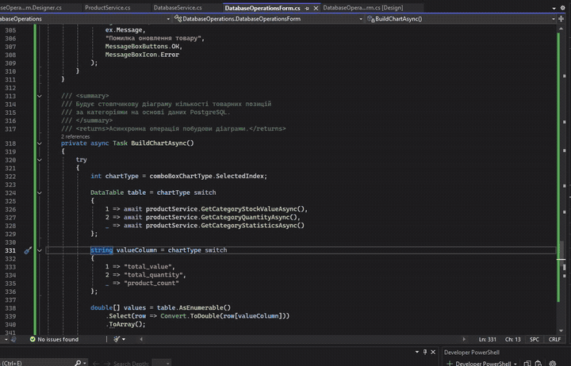
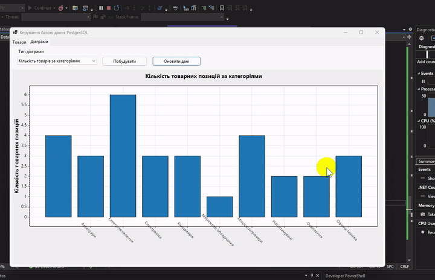


# Практична робота №12. Робота з базою даних у C#

- **Мова програмування:** C#
- **Технологія:** Windows Forms (.NET 8.0)
- **Середовище розробки:** Visual Studio Community 2022
- **СУБД:** PostgreSQL 17
- **Доступ до даних:** ADO.NET, Npgsql
- **Візуалізація:** ScottPlot 5 (ScottPlot.WinForms)
- **Інструменти:** Docker Desktop, JetBrains DataGrip

## Мета роботи

Навчитися виконувати операції керування даними за допомогою SQL-запитів, організовувати взаємодію застосунку C# із реляційною базою даних та відображати результати у Windows Forms. Закріпити навички використання `DataGridView`, `TabControl`, параметризованих SQL-запитів і побудови діаграм на основі даних PostgreSQL.

## Завдання

1. Створити інтерфейс із `TabControl` та кількома вкладками `TabPage`.
2. На одній вкладці розмістити `DataGridView` для роботи з базою даних.
3. На іншій вкладці розмістити компонент для побудови діаграм.
4. Наповнити таблицю щонайменше 30 унікальними записами.
5. Реалізувати щонайменше три типи SQL-запитів, включно з вибіркою за умовою.
6. Реалізувати видалення записів за умовою.
7. Побудувати діаграму за даними таблиці.

## Особливості реалізації

У роботі використано PostgreSQL замість Microsoft Access, а для взаємодії з базою даних - провайдер `Npgsql` замість `OleDb`.

Застосунок працює з базою даних `data_db`, розгорнутою в Docker під час виконання практичної роботи №11. Повторне створення контейнера або окремого екземпляра PostgreSQL не потрібне.

Для побудови діаграм використано бібліотеку `ScottPlot.WinForms`, сумісну з Windows Forms та .NET 8.

## Реалізація

### 1. Структура застосунку

Проєкт `DatabaseOperations` побудовано з розділенням відповідальності між трьома основними класами:

| Клас                     | Призначення                                                                   |
|--------------------------|-------------------------------------------------------------------------------|
| `DatabaseService`        | Підключення до PostgreSQL, виконання SQL-запитів та обробка їхніх результатів |
| `ProductService`         | Реалізація операцій із товарами та формування SQL-запитів                     |
| `DatabaseOperationsForm` | Інтерфейс користувача, обробка подій та відображення даних                    |

Такий підхід дозволяє відокремити логіку інтерфейсу від операцій із базою даних і уникнути дублювання коду підключення.

### 2. Організація бази даних

Для практичної роботи використано таблицю `public.products`, яка містить понад 30 товарних записів.

Структура таблиці:

| Поле         | Тип даних        | Призначення                     |
|--------------|------------------|---------------------------------|
| `id`         | INTEGER          | Унікальний ідентифікатор товару |
| `name`       | TEXT             | Назва товару                    |
| `category`   | TEXT             | Категорія товару                |
| `quantity`   | INTEGER          | Кількість одиниць               |
| `price`      | NUMERIC          | Ціна одиниці                    |
| `weight`     | DOUBLE PRECISION | Вага товару                     |
| `created_at` | TIMESTAMP        | Дата та час створення запису    |

Таблиця містить товари різних категорій: електроніку, периферійні пристрої, накопичувачі, аксесуари, канцелярію, офісну техніку, освітлення, електроживлення та мережеве обладнання.

Наповнення таблиці та перевірка її вмісту виконувалися через JetBrains DataGrip.

### 3. Підключення до PostgreSQL

У класі `DatabaseService` реалізовано:

- `GetConnectionString()` - формування рядка підключення з параметрів файлу `.env`.
- `ExecuteQueryAsync()` - виконання запитів `SELECT` із поверненням результату у `DataTable`.
- `ExecuteNonQueryAsync()` - виконання команд `INSERT`, `UPDATE` та `DELETE`.

Для роботи з PostgreSQL використовуються `NpgsqlConnection`, `NpgsqlCommand` і `NpgsqlParameter`.

Запити виконуються асинхронно з використанням `async/await`. Підключення та інші ресурси звільняються через `await using`.

Параметри підключення винесено до `.env`, що дозволяє не зберігати облікові дані безпосередньо у вихідному коді.

### 4. Інтерфейс користувача

Головна форма містить `TabControl` із двома вкладками:

**Вкладка «Товари»**

Містить таблицю `DataGridView`, панель пошуку та редактор товарів.

Користувач може переглядати записи, виконувати пошук, вибирати товари, додавати нові записи, змінювати наявні та видаляти їх.

При виборі рядка таблиці значення автоматично переносяться до полів редактора. Після успішного додавання або редагування таблиця оновлюється, а поля редактора очищуються.

**Вкладка «Діаграми»**

Містить компонент `FormsPlot` бібліотеки ScottPlot, список типів діаграм та кнопки «Побудувати» й «Оновити дані».

Дані для візуалізації надходять безпосередньо з PostgreSQL через `ProductService`.

### 5. Реалізація SQL-запитів

У `ProductService` реалізовано три варіанти вибірки.

**Отримання всіх товарів:**

```sql
SELECT *
FROM public.products
ORDER BY id;
```

**Пошук за назвою або категорією:**

```sql
SELECT *
FROM public.products
WHERE name ILIKE @search
   OR category ILIKE @search
ORDER BY id;
```

Оператор `ILIKE` дозволяє виконувати пошук без урахування регістру символів. Параметр `@search` передається окремо від тексту SQL-запиту.

**Вибірка товарів із кількістю менше 20:**

```sql
SELECT *
FROM public.products
WHERE quantity < @quantity
ORDER BY id;
```

Для перевірки роботи запитів використовувалися товари з різними категоріями та значеннями кількості. Результати відображалися у `DataGridView`.

### 6. Операції CRUD

Крім вибірки даних, реалізовано повний набір основних операцій керування записами.

| Операція | SQL-команда | Реалізація                               |
|----------|-------------|------------------------------------------|
| Create   | `INSERT`    | `AddAsync()`                             |
| Read     | `SELECT`    | `GetAllAsync()`, `SearchProductsAsync()` |
| Update   | `UPDATE`    | `UpdateAsync()`                          |
| Delete   | `DELETE`    | `DeleteAsync()`                          |

**Додавання товару.** Користувач заповнює назву, категорію, кількість, ціну та вагу. Після натискання кнопки «Додати» виконується параметризований `INSERT`, а таблиця оновлюється.

**Редагування товару.** При виборі рядка дані переносяться до редактора. Після зміни значень кнопка «Зберегти зміни» виконує `UPDATE` за ідентифікатором вибраного запису.

**Видалення товару.** Користувач вибирає рядок та натискає «Видалити». Перед виконанням `DELETE` програма запитує підтвердження. Видалення здійснюється за `id` товару.

Для операцій зміни даних використовується спільний метод `DatabaseService.ExecuteNonQueryAsync()`.



### 7. Побудова діаграм

Для візуалізації даних використано бібліотеку ScottPlot 5.

Реалізовано три показники.

**Кількість товарних позицій за категоріями**

```sql
SELECT
    category,
    COUNT(*)::integer AS product_count
FROM public.products
GROUP BY category
ORDER BY category;
```

Діаграма відображає кількість окремих товарних позицій у кожній категорії.

**Загальна вартість товарних запасів за категоріями**

```sql
SELECT
    category,
    SUM(quantity * price) AS total_value
FROM public.products
GROUP BY category
ORDER BY category;
```

Діаграма показує сумарну вартість товарів у кожній категорії з урахуванням кількості одиниць та ціни.

**Загальна кількість одиниць товару за категоріями**

```sql
SELECT
    category,
    SUM(quantity)::bigint AS total_quantity
FROM public.products
GROUP BY category
ORDER BY category;
```

На відміну від першої діаграми, тут підраховується не кількість товарних позицій, а загальна кількість одиниць товару.

Для побудови використовується стовпчикова діаграма. Назви категорій відображаються на горизонтальній осі, а відповідні числові показники - на вертикальній.



## Результати

У результаті виконання практичної роботи створено Windows Forms застосунок `DatabaseOperations`, який забезпечує взаємодію з PostgreSQL через ADO.NET і Npgsql.

Під час перевірки встановлено:

1. Підключення до PostgreSQL працює, записи успішно завантажуються до `DataGridView`.
2. Реалізовані SQL-запити дозволяють отримувати всі товари та виконувати вибірку за умовами.
3. Додавання нового товару перевірено на тестовому записі «Клавіатура Logitech K120», який отримав автоматично згенерований ідентифікатор.
4. Видалення записів реалізовано з підтвердженням дії користувача.
5. Реалізовано механізм редагування товарів через вибір рядка таблиці та збереження змін.
6. Побудовано діаграми кількості товарних позицій і вартості товарних запасів за категоріями.
7. Реалізовано третій варіант діаграми для аналізу загальної кількості одиниць товару.

Результати роботи застосунку перевірялися також через JetBrains DataGrip, що дозволяло контролювати зміни безпосередньо в базі даних.

## Висновок

## Висново

Під час практичної роботи було реалізовано Windows Forms застосунок для керування даними PostgreSQL 
із використанням C#, ADO.NET та провайдера Npgsql.

Було опрацьовано виконання параметризованих SQL-запитів, асинхронну роботу з базою даних, відображення 
результатів у `DataGridView` та реалізацію основних CRUD-операцій.

Для розділення відповідальності між компонентами застосунку взаємодію з PostgreSQL винесено до `DatabaseService`, 
операції з товарами — до `ProductService`, а обробку дій користувача залишено в класі форми. Це дозволило 
уникнути дублювання логіки підключення до бази даних.

Також реалізовано візуалізацію даних за допомогою ScottPlot. Побудовані діаграми дозволяють порівнювати 
категорії товарів за кількістю позицій, загальною кількістю одиниць та вартістю запасів.

У результаті отримано застосунок, який поєднує роботу з реляційною базою даних, керування записами 
через графічний інтерфейс та візуальне представлення статистичної інформації.
