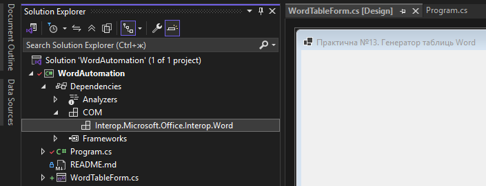
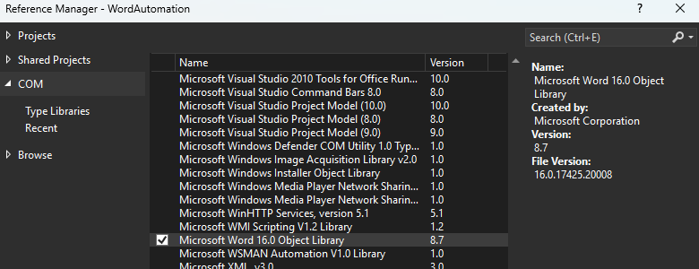
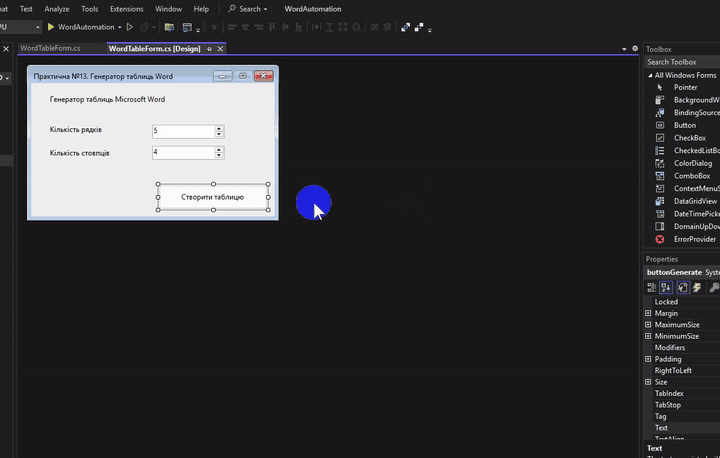

# Практична робота №13. Автоматизоване створення таблиці в Microsoft Word

- Мова програмування: C#
- Технологія: Windows Forms (.NET 8.0)
- Середовище розробки: Visual Studio Community 2022
- Офісний пакет: Microsoft Office LTSC 2024
- Бібліотека: Microsoft.Office.Interop.Word

## Мета роботи

Навчитися створювати та форматувати таблиці в Microsoft Word за допомогою Windows Forms і COM Interop.

## Завдання

- Створювати новий документ Microsoft Word.
- Задавати кількість рядків і стовпців таблиці через `NumericUpDown`.
- Створювати та заповнювати таблицю розміром N × M.
- Встановлювати межі таблиці.
- Центрувати текст у клітинках.
- Виділяти перший рядок жирним шрифтом.
- Додавати центрований заголовок документа.
- Перевіряти наявність Word та обробляти COM-винятки.
- Відкривати створений документ у Word для перегляду.

## Реалізація

### 1. Підключення бібліотеки Microsoft Word

Для взаємодії з Microsoft Word використано технологію COM Interop, 
яка дозволяє застосунку C# керувати об'єктами Word, створювати документи, 
таблиці та змінювати їхнє форматування.

Бібліотеку підключено безпосередньо з установленого Microsoft Office LTSC 2024 через Visual Studio

`Solution Explorer` => `Add COM Reference` => `COM Microsoft Word 16.0 Object Library` => `OK`





Для зручного звернення до класів бібліотеки в коді використано псевдонім простору імен:

```csharp
using System.Runtime.InteropServices;
using Word = Microsoft.Office.Interop.Word;
```

### 2. Інтерфейс застосунку

Створено Windows Forms застосунок WordAutomation із головною формою WordTableForm.

| Компонент       | Name             | Text / Value                     |
|-----------------|------------------|----------------------------------|
| `Label`         | `labelTitle`     | Генератор таблиць Microsoft Word |
| `Label`         | `labelRows`      | Кількість рядків                 |
| `Label`         | `labelColumns`   | Кількість стовпців               |
| `NumericUpDown` | `numericRows`    | 5                                |
| `NumericUpDown` | `numericColumns` | 4                                |
| `Button`        | `buttonGenerate` | Створити таблицю                 |

Компоненти `NumericUpDown` дозволяють задавати розміри таблиці. 
Для обох встановлено мінімальне значення 1 та максимальне 20.

Натискання кнопки `buttonGenerate` викликає обробник події `buttonGenerateClick(`), 
який виконує створення документа.

### 3. Створення документа Microsoft Word

Спочатку програма отримує кількість рядків і стовпців із компонентів форми:

```csharp
int rows = (int)numericRows.Value;
int columns = (int)numericColumns.Value;
```

Для автоматизації Word створюється екземпляр `Word.Application`, 
після чого методом `Documents.Add()` додається новий порожній документ:

```csharp
word = new Word.Application();
document = word.Documents.Add();
```

Документ створюється безпосередньо в Microsoft Word і на цьому етапі не зберігається на диск.

### 4. Формування заголовка та таблиці

Заголовок створюється через `Word.Paragraph`. Для нього встановлюються жирний шрифт,
розмір 16 пунктів і центрування.

```csharp
Word.Paragraph title = document.Paragraphs.Add();
title.Range.Text = "Автоматично згенерована таблиця";
title.Range.Font.Bold = 1;
title.Range.Font.Size = 16;
title.Alignment = Word.WdParagraphAlignment.wdAlignParagraphCenter;
title.Range.InsertParagraphAfter();
```

Таблиця розміром N × M додається після заголовка методом `Tables.Add()`.

```csharp
Word.Range range = document.Range(
    document.Content.End - 1,
    document.Content.End - 1
);

Word.Table table = document.Tables.Add(range, rows, columns);
```

Встановлюються межі таблиці, центрування тексту та звичайний шрифт розміром 11 пунктів.

```csharp
table.Borders.Enable = 1;
table.Range.ParagraphFormat.Alignment =
    Word.WdParagraphAlignment.wdAlignParagraphCenter;

table.Range.Font.Bold = 0;
table.Range.Font.Size = 11;
```

### 5. Заповнення клітинок

Два вкладені цикли `for` послідовно заповнюють усі клітинки. Перший рядок містить назви стовпців, 
решта координати клітинок.

```csharp
for (int i = 1; i <= rows; i++)
{
    for (int j = 1; j <= columns; j++)
    {
        table.Cell(i, j).Range.Text =
            i == 1
                ? $"Стовпець {j}"
                : $"Рядок {i}, стовпець {j}";
    }
}
```

Індексація рядків і стовпців у Word починається з `1`. Перший рядок виділяється жирним шрифтом:

```csharp
table.Rows[1].Range.Bold = 1;
```

### 6. Відкриття документа та обробка помилок

Після генерації документ відкривається у Microsoft Word:

```csharp
word.Visible = true;
word.Activate();
```

Користувач може переглянути, відредагувати та зберегти документ.

Обробка винятків реалізована через `try...catch`. Для помилок COM використовується `COMException`, 
для інших помилок `Exception`. Повідомлення виводяться через `MessageBox.Show()`.

У разі помилки Word закривається без збереження методом `Quit()`.

## Результати

Створено Windows Forms застосунок для автоматизованої генерації таблиць Microsoft Word через COM Interop.

Реалізовано:

- Введення розмірів таблиці через `NumericUpDown`.
- Створення документа та таблиці розміром N × M.
- Автоматичне заповнення клітинок.
- Центрування заголовка та тексту таблиці.
- Встановлення меж і виділення першого рядка жирним.
- Обробку помилок COM та відкриття документа у Word.

Перевірено створення таблиці із заданим форматуванням.



## Висновок

Опрацьовано автоматизацію Microsoft Word засобами C# та COM Interop. 
Отримано навички роботи з об'єктами `Application`, `Document`, `Paragraph`, `Range` і `Table`, 
форматування документів та обробки винятків.