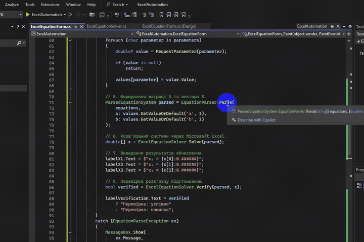

# Практична робота №14. Використання функцій Microsoft Excel у C#

- Мова програмування: C#
- Технологія: Windows Forms (.NET 8.0)
- Середовище розробки: Visual Studio Community 2022
- Офісний пакет: Microsoft Office LTSC 2024
- Бібліотека: Microsoft.Office.Interop.Excel

## Мета роботи

Навчитися використовувати функції Microsoft Excel у застосунках C# через COM Interop.

## Завдання

- Створити Windows Forms застосунок.
- Реалізувати розв'язання заданої системи трьох лінійних рівнянь.
- Використати матричні функції Microsoft Excel для обчислення розв'язку.
- Вивести отримані значення невідомих у формі.
- Перевірити правильність результату.
- Дати відповіді на контрольні питання щодо підключення бібліотек і використання функцій Excel.

## Реалізація

### 1. Створення інтерфейсу застосунку

Створено Windows Forms застосунок `ExcelAutomation`. 
Головну форму перейменовано з `Form1`на `ExcelEquationForm`.

| Компонент | Name                | Text / Призначення               |
|-----------|---------------------|----------------------------------|
| Label     | `labelTitle`        | Система лінійних рівнянь         |
| TextBox   | `textEquation1`     | `2x1+3x2+5x3=10`                 |
| TextBox   | `textEquation2`     | `3x1+7x2+4x3=3`                  |
| TextBox   | `textEquation3`     | `x1+2x2+2x3=3`                   |
| Label     | `labelVariant`      | Варіант системи                  |
| ComboBox  | `comboVariant`      | Вибір варіанта від 1 до 14       |
| Button    | `buttonSolve`       | Розв'язати систему               |
| Label     | `labelSeparator`    | Горизонтальний розділювач        |
| Label     | `labelResultTitle`  | Результати обчислення            |
| Label     | `labelX1`           | x₁ = ...                         |
| Label     | `labelX2`           | x₂ = ...                         |
| Label     | `labelX3`           | x₃ = ...                         |
| Label     | `labelVerification` | Перевірка: очікування обчислення |

Компоненти `TextBox` дозволяють вводити рівняння вручну звичайними символами клавіатури.

### 2. Програмне малювання фігурної дужки

Для об'єднання трьох рівнянь у систему створено статичний клас `BraceRenderer`, який використовує GDI+.

Метод `DrawBrace()` будує фігурну дужку за допомогою `GraphicsPath` і кривих Безьє (`AddBezier`).

Метод приймає координати `x`, `y`, розміри `width`, `height`, товщину `thickness`, 
колір `color` та напрямок `opening`.

Малювання виконується в обробнику події `ExcelEquationForm_Paint`:

```csharp
private void ExcelEquationForm_Paint(object sender, PaintEventArgs e)
{
    float x = textEquation1.Left - 20;
    float y = textEquation1.Top;
    float height = textEquation3.Bottom - textEquation1.Top;

    BraceRenderer.DrawBrace(
        e.Graphics,
        x,
        y,
        width: 10,
        height: height,
        thickness: 1.2f
    );
}
```

Положення дужки визначається координатами першого та останнього полів введення. 
Для згладжування ліній використовується `SmoothingMode.AntiAlias`.

### 3. Зберігання варіантів систем рівнянь

Для зберігання 14 варіантів систем створено файл `data/equation-systems.json`.

Кожен варіант містить номер `id` та масив `equations` із трьох рівнянь:

```json
{
  "id": 1,
  "equations": [
    "2x1+3x2+5x3=10",
    "3x1+7x2+4x3=3",
    "x1+2x2+2x3=3"
  ]
}
```

Для файлу встановлено `Build Action = Content` 
та `Copy to Output Directory = Copy if newer`.

Завантаження реалізовано в окремому класі `EquationSystemRepository`,
який використовує `System.Text.Json`.

Метод `Load()` читає JSON, десеріалізує список систем, перевіряє наявність 
трьох рівнянь у кожному варіанті та унікальність номерів.

### 4. Завантаження систем у випадний список

У конструкторі `ExcelEquationForm` після `InitializeComponent()` 
викликається `EquationSystemRepository.Load()`.

Отриманий список прив'язується до компонента `comboVariant`:

```csharp
systems = EquationSystemRepository.Load();

comboVariant.DisplayMember = nameof(EquationSystem.Id);
comboVariant.ValueMember = nameof(EquationSystem.Id);
comboVariant.DataSource = systems;
```

Для обробки вибору використовується подія `SelectedIndexChanged`.

```csharp
private void comboVariant_SelectedIndexChanged(
    object sender,
    EventArgs e)
{
    if (comboVariant.SelectedItem is not EquationSystem system)
        return;

    textEquation1.Text = system.Equations[0];
    textEquation2.Text = system.Equations[1];
    textEquation3.Text = system.Equations[2];

    labelX1.Text = "x₁ = ...";
    labelX2.Text = "x₂ = ...";
    labelX3.Text = "x₃ = ...";

    labelVerification.Text = "Перевірка: очікування обчислення";
}
```

### 5. Реалізація парсера систем лінійних рівнянь

Створено статичний клас `EquationParser`, який перетворює текстове представлення трьох лінійних рівнянь 
на матрицю коефіцієнтів `A` та вектор вільних членів `B`.

Парсер підтримує змінні `x1`, `x2`, `x3`, цілі та дробові коефіцієнти, 
відсутні члени рівнянь і параметри `a`, `b`.

Обробку організовано в окремі методи:

| Метод                 | Призначення                                                |
|-----------------------|------------------------------------------------------------|
| `Parse()`             | Координація перевірок і формування системи                 |
| `Normalize()`         | Видалення пробілів, нормалізація символів                  |
| `Validate()`          | Послідовне застосування правил валідації                   |
| `ParseSide()`         | Розбір математичних членів і коефіцієнтів                  |
| `FormatDiagnostics()` | Формування діагностичного представлення матриці та вектора |

Правила валідації описано декларативно через масив `ValidationRule[]`. Кожне правило містить повідомлення 
про помилку та предикат `Func<string, bool>`.

Для розпізнавання математичних членів використовується `Regex`, а для визначення параметрів і змінних 
застосовуються конструкції `switch`.

#### Перевірки парсера

| №  | Перевірка                                      | Приклад некоректного введення |
|----|------------------------------------------------|-------------------------------|
| 1  | Рівняння не повинно бути порожнім              | Порожній рядок                |
| 2  | Наявність рівно одного знака `=`               | `2x1+x2=3=5`                  |
| 3  | Обидві частини рівняння повинні бути заповнені | `2x1+x2=`                     |
| 4  | Відсутність недопустимих символів              | `2x1+@x2=5`                   |
| 5  | Використання лише змінних `x1`, `x2`, `x3`     | `2x1+3x4=5`                   |
| 6  | Коректність запису математичних членів         | `2x1+*x2=5`                   |
| 7  | Наявність члена після знака операції           | `2x1+x2+=5`                   |
| 8  | Коректність параметричних коефіцієнтів         | `2abx1+bx2=5`                 |
| 9  | Відсутність числового переповнення             | Надмірно великий коефіцієнт   |
| 10 | Наявність рівно трьох рівнянь у системі        | Масив із двох рівнянь         |

У разі помилки парсер формує `EquationParseException` із номером відповідного рівняння та описом порушення.

#### Діагностичний режим

Для перевірки роботи парсера тимчасово використовується `MessageBox`, який відображає отриману 
матрицю коефіцієнтів і вектор вільних членів.

Тимчасова логіка обробника кнопки для налагодження парсера

Наведений обробник використовувався на етапі тестування парсера. 
У фінальній реалізації діагностичний вивід замінено викликом `ExcelEquationSolver`

```csharp
    private void button1_Click(object sender, EventArgs e)
    {
        try
        {
            // 1. Отримання трьох рівнянь із полів введення.
            string[] equations =
            {
            textEquation1.Text,
            textEquation2.Text,
            textEquation3.Text
        };

            // 2. Перевірка синтаксису та формування матриці A і вектора B.
            ParsedEquationSystem parsed = EquationParser.Parse(
                equations,
                a: 1,
                b: 1
            );

            // 3. Діагностичний вивід результатів парсера.
            MessageBox.Show(
                EquationParser.FormatDiagnostics(parsed),
                "Діагностика парсера",
                MessageBoxButtons.OK,
                MessageBoxIcon.Information
            );
        }
        catch (EquationParseException ex)
        {
            // 4. Виведення помилки синтаксису рівняння.
            MessageBox.Show(
                ex.Message,
                "Помилка синтаксису",
                MessageBoxButtons.OK,
                MessageBoxIcon.Warning
            );
        }
        catch (Exception ex)
        {
            // 5. Обробка інших помилок.
            MessageBox.Show(
                ex.Message,
                "Помилка",
                MessageBoxButtons.OK,
                MessageBoxIcon.Error
            );
        }
    }
```

Помилки:


Правильний запис:


Запис с параметром:


Параметри a та b визначаються автоматично під час аналізу рівнянь. Значення запитуються через програмно створені 
діалогові вікна в порядку першої появи параметрів. Повторні параметри використовують раніше введене значення.

## Результати

Реалізовано розв'язання систем трьох лінійних рівнянь із використанням 
Microsoft Excel COM Interop. Застосунок підтримує 14 підготовлених варіантів, 
ручне редагування рівнянь, введення параметричних коефіцієнтів, перевірку 
синтаксису та контроль правильності розв'язку методом підстановки.

